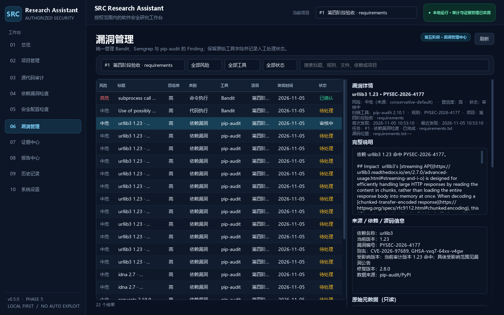
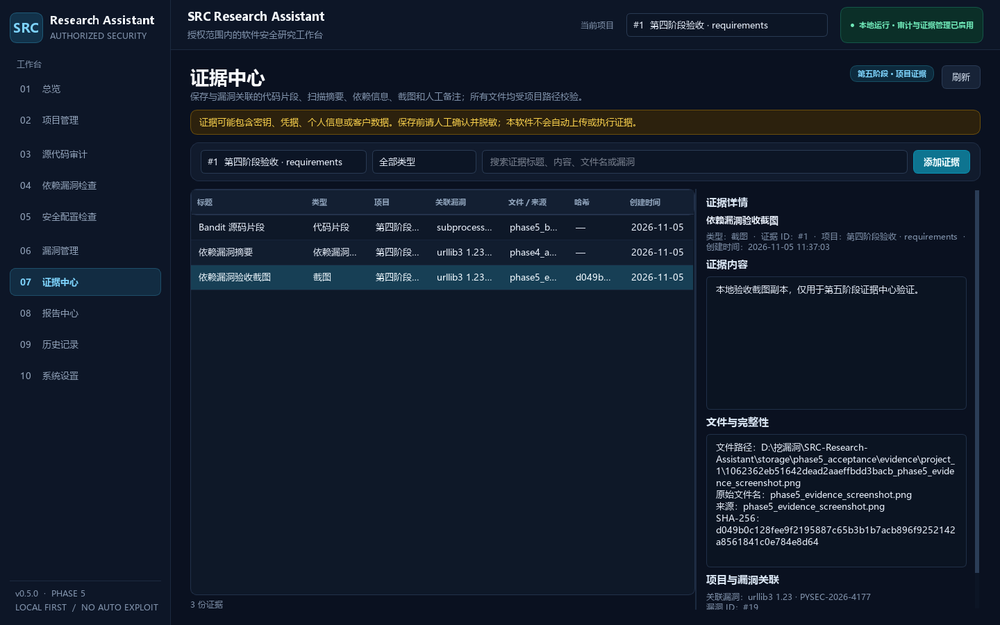
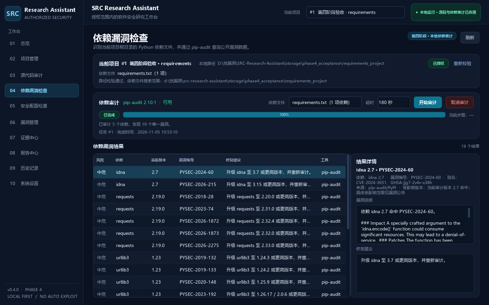
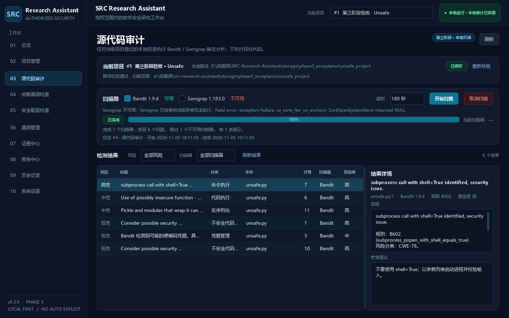
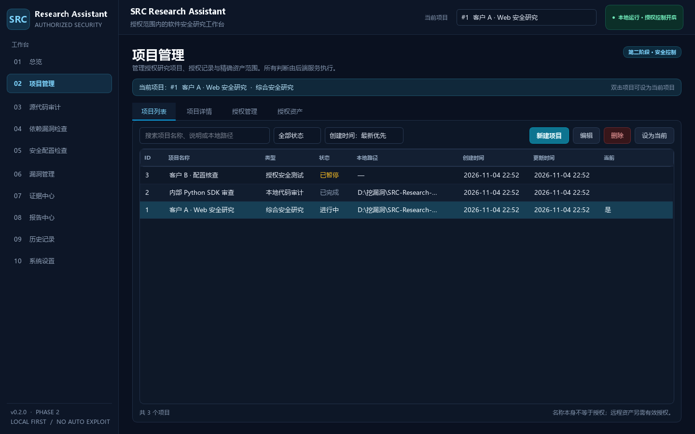
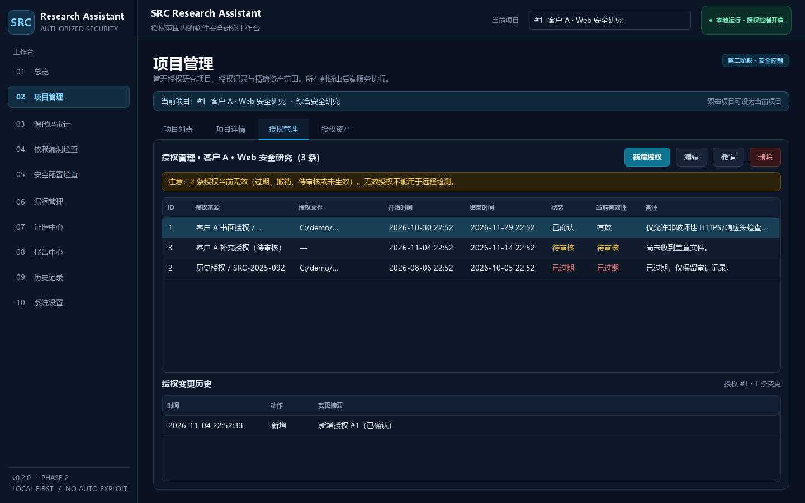
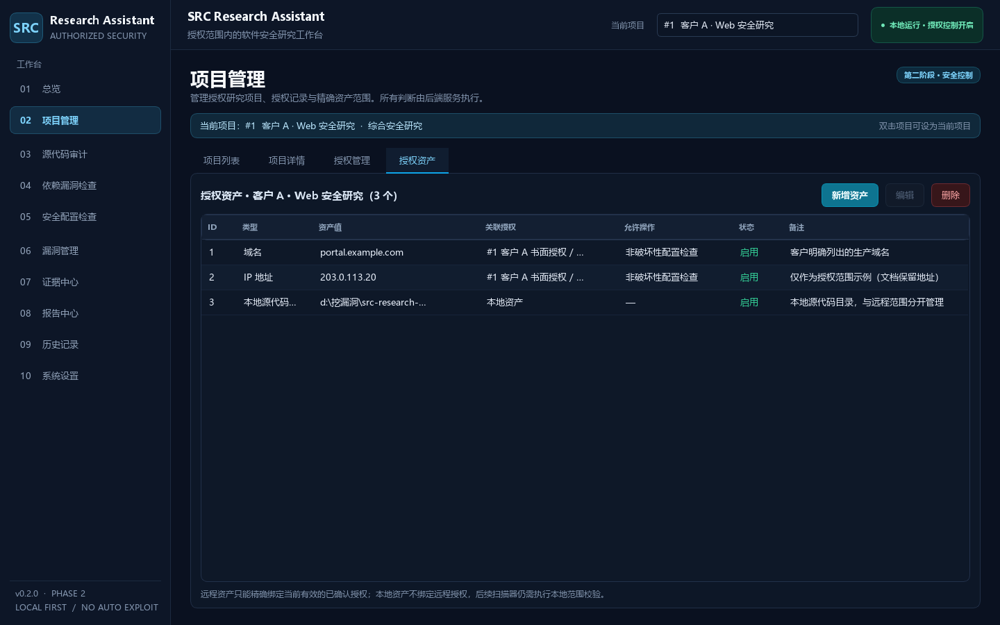
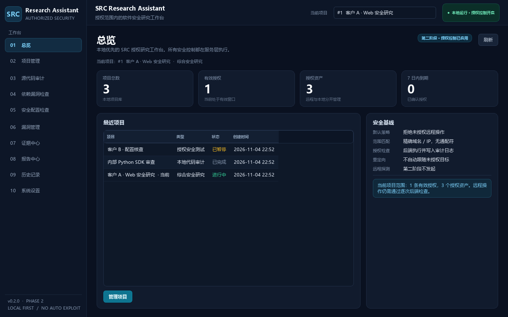

# SRC Research Assistant

面向合法授权软件安全研究的 Windows 桌面工作台。当前版本 `0.5.0` 完成**第一阶段基础框架、第二阶段项目管理/授权控制、第三阶段本地 Python 源代码审计、第四阶段 Python 依赖漏洞审计、第五阶段漏洞管理与证据中心**。

> 本软件只用于已获得明确书面授权的安全研究。第五阶段只管理本地扫描结果和项目证据；不包含远程漏洞扫描、网站扫描、漏洞利用、密码爆破、自动攻击、证据上传或报告生成能力。



## 项目起点说明（重要）

本会话开始时，工作区 `D:\挖漏洞` 中没有第一阶段项目目录、源代码、数据库或主窗口，只有空目录。为避免把不存在的功能描述成“已完成”，本次开发先补齐了可运行的第一阶段基础框架并完成基线测试，再在其上实现第二阶段，随后继续扩展第三阶段本地源代码审计。

因此：

- **没有删除或覆盖任何用户已有项目文件**；
- 不存在可供执行的“第二阶段开发前旧版本备份”；
- 阶段完成后的可恢复源码/数据库快照会生成在 `backups/`，用于下一阶段前回滚参考；
- 当前交付包含第一至第五阶段，不包含第六阶段。

## 当前环境（实际验证）

| 项目 | 结果 |
|---|---|
| 操作系统 | Windows 11 `10.0.26300` |
| Python | `3.14.4`（64 位） |
| pip | 虚拟环境 `26.3` |
| Qt 绑定 | PySide6-Essentials `6.12.0` |
| SQLite | `3.50.4`，外键 `ON` |
| Bandit | `1.9.4`，实际可运行 |
| Semgrep | `1.183.0` 已安装；当前 Windows 会话因系统证书存储初始化失败而标记不可用 |
| pip-audit | `2.10.1`，实际可运行 |
| 虚拟环境 | 本机测试使用 `D:\挖漏洞\.venv`（工作区上级） |
| 数据库 | `storage/src_research.db`，schema `v5` |
| 自动化测试 | `126 passed / 1 skipped`（pytest，offscreen Qt；skip 为无权限创建文件符号链接） |

## 已实现功能

### 1. 现代化桌面界面

- 左侧固定导航、右侧内容区、顶部软件名称 / 当前项目 / 系统状态。
- 10 个导航页面：总览、项目管理、源代码审计、依赖漏洞检查、安全配置检查、漏洞管理、证据中心、报告中心、历史记录、系统设置。
- 深色 Windows 风格 QSS、原生最大化 / 关闭按钮、窗口最小尺寸 1180×720。
- 源代码审计、依赖漏洞检查、漏洞管理、证据中心已实现；其余 2 个未进入本阶段的功能页（安全配置检查、报告中心）显示明确“未开发”占位状态和计划功能，不伪造结果。

### 2. 项目管理

- 新建、编辑、删除、查看详情。
- 字段：`project_id`、`project_name`、`project_type`、`description`、`local_path`、`status`、`created_at`、`updated_at`。
- 支持项目类型、状态筛选、关键词搜索、创建时间升降序。
- 支持设置当前活动项目；当前项目持久化到数据库，并在顶部选择器同步。
- 删除项目级联删除授权、资产和历史；审计日志保留。

### 3. 授权管理

- 授权来源、授权文件路径、起止时间、状态、备注。
- 状态：待审核、已确认、已过期、已撤销。
- “已确认”必须有来源和授权文件路径；仅填写项目名称不会产生任何授权。
- 有效性 = 已确认 + 当前时间落在授权窗口内；过期/撤销/待审核均立即拒绝远程操作。
- 应用启动时把已超期的确认授权持久化为已过期。
- 授权变更历史（新增、修改、撤销、到期、删除）落库；撤销是终态，需重新新增授权。
- 有关联资产时后端拒绝删除授权。

### 4. 授权资产

- 类型：域名、IP 地址、本地文件夹、本地源代码项目。
- 远程资产必须绑定**当前有效的已确认授权**，必须明确勾选允许操作。
- 域名/IP 严格精确匹配：拒绝通配符、URL、端口、CIDR、userinfo；子域名不会被父域名覆盖。
- 本地资产与远程资产分开管理；本地资产不允许绑定远程授权或远程操作。
- 支持资产新增、编辑、删除和启停。
- DNS 解析结果复核 API：拒绝空结果、非公网 IP、解析异常；远程扫描器在后续阶段必须传入解析快照。
- 重定向辅助校验：来源和目标都必须通过精确范围检查；本阶段不存在自动跟随重定向的代码。

### 5. 后端安全控制

- `AuthorizationService`：授权 CRUD、状态、规范化时间、变更历史。
- `ScopeValidator`：默认拒绝、精确资产匹配、授权归属校验、时间窗口校验、操作白名单、DNS/IP 快照复核。
- 不依赖 UI 隐藏按钮：直接调用服务层同样会被拒绝。
- 每次授权检查写入 SQLite `scan_logs` 与 `storage/logs/audit.jsonl`。
- 审计写入失败时，原本允许的请求也会被改为拒绝（fail closed）。
- 不存在远程请求实现；第三阶段不会连接任何真实 SRC 目标。

### 6. 本地 Python 源代码审计

- 只扫描当前项目中登记的本地源码资产，扫描前后端再次调用 `ScopeValidator.check_local_path`。
- 复用路径校验并补充：不存在、非目录、权限不足、相对路径、`..` 越界均拒绝。
- **Bandit 1.9.4**：通过 `subprocess` 参数列表调用，`shell=False`，JSON 解析，超时/取消/错误处理。
- **Semgrep**：已实现统一接口、项目内本地规则（`scanners/rules/python_security.yml`）和 JSON 解析；当前 Windows 会话运行 Semgrep 时系统 CA 存储初始化失败，UI 真实显示不可用和原因，不伪造结果。
- 统一 `Finding`：风险等级、置信度、文件、行号、规则、扫描器版本、修复建议。
- 扫描任务：`pending → running → completed/failed/cancelled`，持久化进度、当前扫描器、错误和结果。
- 取消通过 `threading.Event` 传递，子进程会被终止；超时同样终止并标记失败。
- 空结果标记为 `completed`，不视为失败。
- 扫描结果保存到 `findings`，按项目和任务隔离；硬编码凭据值不会写入结果。
- 后台 `QThread` 执行扫描，UI 只调用 Service 层，不直接调用 Bandit/Semgrep。

### 7. 本地 Python 依赖漏洞审计

- 只检查当前项目根目录的 `requirements.txt` 和 `pyproject.toml`，不扫描项目范围外文件。
- `requirements.txt` 直接交给 pip-audit；`pyproject.toml` 仅提取 PEP 621 `[project].dependencies`，在项目自有临时目录生成审计输入，任务结束后清理。
- 没有可识别依赖文件时，UI 明确显示“未发现可审计依赖”，不会创建成功任务或伪造结果。
- **pip-audit 2.10.1**：通过安全参数列表启动，`shell=False`，JSON 输出，超时/取消/执行失败/解析失败处理。
- 依赖漏洞转换为统一 `Finding`，并在 `metadata_json` 保存依赖名称、当前版本、漏洞编号、别名、修复版本、受影响说明、数据来源。
- 区分：
  - `completed + 0 Finding`：已实际审计，未发现已知漏洞；
  - `failed`：工具不可用、执行/解析失败、超时或未审计到任何依赖；
  - `cancelled`：用户取消。
- 扫描任务复用现有 `ScanTask`，任务类型为 `dependency_audit`，继续按项目隔离。
- UI 在后台线程运行，支持依赖文件选择、开始/取消、状态/步骤/完成时间、结果详情。
- 任务取消/异常不会标记为 completed。

### 8. 漏洞管理中心

- 统一汇总 Bandit、Semgrep、pip-audit Finding，不合并或改写原始扫描器字段。
- 保留扫描器名称/版本、规则编号、文件/行号、依赖 metadata、任务和项目关联。
- 列表支持项目、风险等级、扫描器、处理状态和关键词筛选；列表查询在 QThread 中执行。
- 处理状态：待处理、审核中、已确认、误报、已修复、接受风险。
- 状态变更写入 `findings.status`、`status_changed_at`，并追加 `finding_status_history`。
- 人工备注保存到 `manual_notes`，不删除 Finding。
- 详情显示完整说明、风险来源、工具/版本、规则、项目、任务、首次/最近发现时间、源码或依赖信息、原始 metadata、关联证据和状态历史。
- 所有读取/修改都校验 `project_id`，不在项目之间共享或串用记录。

### 9. 证据中心

- 证据类型：代码片段、扫描器结果摘要、依赖漏洞信息、截图、人工备注、其他本地证据文件。
- 一条漏洞可关联多份证据；一份证据只属于一个项目和一个 Finding。
- 文本证据保存在 `description`；文件证据复制到应用自有 `storage/evidence/project_<id>/` 目录，使用 UUID 文件名避免覆盖。
- 文件证据保存 SHA-256、来源相对路径、原始文件名和创建时间。
- 文件源必须同时满足：
  - 项目已登记本地资产；
  - `ScopeValidator.check_local_path` 通过；
  - 绝对路径、真实文件、位于项目根目录内；
  - 拒绝符号链接/目录联接越界、`..` 路径遍历和超过 50 MB 的文件。
- 不执行证据文件、不上传证据、不读取项目外文件。
- 删除证据先人工确认；只删除证据记录和受管副本，不删除源文件，不删除 Finding。
- 证据详情可跳转到关联漏洞；漏洞详情可查看并跳转到全部证据。

### 10. 数据库

当前 schema 共 11 张业务/审计表：

`projects`、`authorizations`、`scan_tasks`、`findings`、`evidence`、`reports`、`scan_logs`、`scope_assets`、`authorization_history`、`app_settings`、`finding_status_history`。

- 统一 `Database` 连接管理，每条连接启用 `foreign_keys=ON`、`busy_timeout`。
- 短连接 + `BEGIN IMMEDIATE` 事务，异常回滚。
- schema v1 → v2 → v3 → v4 → v5 前自动复制数据库到 `storage/backups/`。
- v3 为 `scan_tasks` 增加进度/当前扫描器/错误/取消字段，为 `findings` 增加统一扫描字段。
- v4 为 `findings` 增加 `metadata_json`，保存依赖漏洞的结构化元数据。
- v5：
  - 重建 `findings` 以允许 `reviewing` 状态，增加 `manual_notes`、`status_changed_at`、`last_seen_at`；
  - 为 `evidence` 增加 `evidence_type`、`title`、`source`；
  - 新增 `finding_status_history`；
  - v5 迁移在单一显式事务中执行，失败自动回滚，备份保留。
- 拒绝打开高于程序支持版本的数据库，避免降级破坏。

### 11. 审计与历史

- 历史记录页可查看项目/授权/资产变更以及授权检查的 allow/deny 结论。
- 项目、授权、资产变更均在业务事务内写审计。
- 当前项目切换也记录审计事件。

## 本阶段明确未实现

以下功能只显示占位页，不能当作已完成功能使用：

- 远程 HTTPS / 安全响应头非破坏性检测；
- 外部漏洞记录批量导入；
- HTML / PDF / JSON 报告；
- Windows EXE 打包。

Semgrep 的实际运行状态在当前环境为不可用；其扫描器、规则和解析代码已完成，但不会伪造扫描结果。其他扫描器功能已由 Bandit 实际验证。

这些属于后续阶段，需在完成对应测试、授权前置校验和审计后单独启用。

## 安装与启动

推荐使用项目内虚拟环境。Python 3.10+，本机验证为 3.14.4。

```powershell
cd D:\挖漏洞\SRC-Research-Assistant
python -m venv .venv
.\.venv\Scripts\python.exe -m pip install -r requirements.txt
.\.venv\Scripts\python.exe main.py
```

本机现有虚拟环境位于上一级目录，可直接运行：

```powershell
& 'D:\挖漏洞\.venv\Scripts\python.exe' 'D:\挖漏洞\SRC-Research-Assistant\main.py'
```

初始化或升级数据库并检查表：

```powershell
& 'D:\挖漏洞\.venv\Scripts\python.exe' main.py --init-db
```

使用自定义配置：

```powershell
& 'D:\挖漏洞\.venv\Scripts\python.exe' main.py --config .\config.yaml
```

### 启动失败排查

- 确认在项目根目录运行 `main.py`，或使用绝对路径。
- 确认 `PySide6-Essentials` 已安装：`.\.venv\Scripts\python.exe -c "import PySide6; print(PySide6.__version__)"`。
- 配置文件缺失或路径错误会直接退出，不会静默使用未授权默认值。
- 数据库初始化失败会显示错误并返回非零退出码；日志在 `storage/logs/app.log`。

## 测试

```powershell
& 'D:\挖漏洞\.venv\Scripts\python.exe' -m pytest -q
```

当前结果：**126 passed / 1 skipped**。覆盖：

1. 项目、授权、资产、扫描任务、项目隔离与 v2→v5 数据库迁移；
2. `check_local_path` 的不存在路径、文件路径、权限不足、路径遍历、非法路径；
3. Finding 模型、三种扫描器统一读取、依赖漏洞元数据；
4. Bandit/Semgrep/pip-audit JSON 解析、空结果、错误、超时、不可用；
5. `requirements.txt`、`pyproject.toml` 识别、优先级、无依赖文件；
6. pip-audit 去重、升级建议、版本信息、数据来源、未审计到依赖的失败语义；
7. ScanTask 状态变化、空结果、失败、超时、取消、数据隔离；
8. 漏洞状态持久化、状态历史、人工备注、项目隔离、详情完整性；
9. 证据多关联、文件复制、SHA-256、路径越界/目录联接/模拟符号链接分支、删除后 Finding 保留；
10. 真实 Bandit 扫描、真实 pip-audit 依赖审计、真实本地证据副本；
11. 漏洞管理/证据中心页面加载、筛选、状态保存、跨页跳转和删除确认。

测试不访问真实 SRC 目标，使用临时 SQLite 数据库和 offscreen Qt。文件符号链接实际创建在当前 Windows 会话因 `WinError 1314` 跳过；目录联接越界为实际测试，显式 `is_symlink` 分支另有单元测试。详细结果见 [第五阶段验收报告](docs/acceptance/PHASE5_ACCEPTANCE_REPORT.md) 和 [第五阶段测试报告](docs/acceptance/PHASE5_TEST_REPORT.md)。

## 界面截图

### 第五阶段：漏洞管理与证据中心




截图来自 `storage/phase5_acceptance/acceptance.db`：3 条真实 Bandit 结果 + 19 条第四阶段真实 pip-audit 结果，以及 3 份真实本地证据。Semgrep 的真实不可用状态仍保留。

### 第四阶段：依赖漏洞检查



截图来自真实 pip-audit 扫描 `storage/phase4_acceptance/acceptance.db` 对应的本地 `requirements.txt` 测试项目。

### 第三阶段：源代码审计



截图来自真实 Bandit 扫描 `storage/phase3_acceptance/acceptance.db` 对应的本地测试项目；Semgrep 的真实不可用状态也显示在页面中。

### 第一、二阶段页面

| 项目列表 | 授权管理 |
|---|---|
|  |  |

| 授权资产 | 总览 |
|---|---|
|  |  |

截图由 `tools/capture_ui.py` / `capture_phase3_ui.py` / `capture_phase4_ui.py` / `capture_phase5_ui.py` 使用本地验收数据在 offscreen Qt 渲染生成，不连接任何目标。

重新生成截图：

```powershell
$env:QT_QPA_PLATFORM='offscreen'
& 'D:\挖漏洞\.venv\Scripts\python.exe' tools\capture_ui.py
& 'D:\挖漏洞\.venv\Scripts\python.exe' tools\capture_phase3_ui.py
& 'D:\挖漏洞\.venv\Scripts\python.exe' tools\capture_phase4_ui.py
& 'D:\挖漏洞\.venv\Scripts\python.exe' tools\capture_phase5_ui.py
```

## 目录结构

```text
SRC-Research-Assistant/
├── main.py
├── config.yaml
├── requirements.txt
├── README.md
├── pytest.ini
├── app/                    # 配置、启动、组合根、Qt 入口
├── core/                   # 错误、时间、数据模型
├── database/               # 统一连接、schema、迁移
├── security/               # 范围规则与 fail-closed ScopeValidator
├── services/               # 项目/授权/审计/扫描/漏洞/证据服务
├── repositories/           # 第五阶段漏洞与证据 SQL Repository
├── ui/                     # 主窗口、主题、10 个页面
├── scanners/               # 统一接口、Bandit、Semgrep、pip-audit、本地规则
├── reports/                # 后续报告边界（未启用）
├── storage/                # 主库、第三/四/五阶段验收库、证据、日志
├── tests/                  # pytest 测试
├── tools/                  # 验收、截图、扫描、备份工具
├── docs/                   # 架构、测试与验收报告、截图
└── backups/                # 阶段快照
```

更完整的模块依赖、数据模型与安全调用链见 [基础架构说明](docs/ARCHITECTURE.md)、[第三阶段扫描架构](docs/PHASE3_ARCHITECTURE.md)、[第四阶段依赖审计架构](docs/PHASE4_ARCHITECTURE.md) 和 [第五阶段漏洞/证据架构](docs/PHASE5_ARCHITECTURE.md)。第五阶段证据见 [第五阶段验收报告](docs/acceptance/PHASE5_ACCEPTANCE_REPORT.md) 和 [第五阶段测试报告](docs/acceptance/PHASE5_TEST_REPORT.md)。

## 安全边界

1. 不实现自动漏洞利用、密码爆破、数据窃取、横向移动、持久化、拒绝服务。
2. 不实现远程检测；后续远程功能必须经过 `ScopeValidator.require_remote_access`。
3. 本地源代码扫描和依赖审计必须通过 `ScopeValidator.check_local_path`；不读取未登记目录。
4. 扫描器使用参数列表启动子进程，禁止 `shell=True`；超时/取消会终止子进程。
5. 不把工具原始 JSON 作为业务数据；统一 Finding 只保存必要字段，凭据值不写入结果。
6. pip-audit 只读取当前项目根目录的依赖文件，并向公开漏洞服务发送依赖名称/版本；不上传源码。
7. 证据文件必须位于当前授权项目根目录内，通过 `check_local_path`，拒绝符号链接/目录联接越界、路径遍历和超大文件。
8. 证据只复制到应用自有目录，不执行、不上传、不删除原始源文件；删除证据不删除 Finding。
9. 远程授权必须同时满足：项目归属、资产精确匹配、资产启用、已确认状态、来源/文件齐全、当前在授权窗口内、允许操作包含本次操作。
10. 审计写入失败时默认拒绝，不因异常放行。
11. 证据与报告不采集与授权项目无关的数据。

## Semgrep 待办（不阻塞第五阶段）

Semgrep 1.183.0 已安装，但当前 Windows 会话中 `semgrep.exe` 及其 `semgrep-core.exe` 均在证书存储初始化阶段失败：

```text
ca_certs_iter_on_anchors: CertOpenSystemStore returned NULL
```

待办：

1. 在 Linux/WSL 或其他可运行 Semgrep 的环境验证本地规则语法；
2. 扫描实际测试项目；
3. 验证 Finding JSON 解析和 UI 展示；
4. 不删除或伪造当前不可用状态。

## 下一阶段建议

1. 实现 HTML/PDF/JSON 报告，并复用第五阶段漏洞/证据关联。
2. 实现远程非破坏性配置检查，必须先展示目标、检测方式和授权状态，并强制通过 `require_remote_access`。
3. 在 Linux/WSL 完成 Semgrep 实际运行验证。
4. Windows EXE 打包放在功能稳定后。
5. 保留 pip-audit 当前 severity/affected range 已知限制，不擅自改写；如需 CVSS，应单独设计经过验证的补充来源。

第五阶段在此停止，不进入报告模块；等待用户审查第五阶段验收结果。
