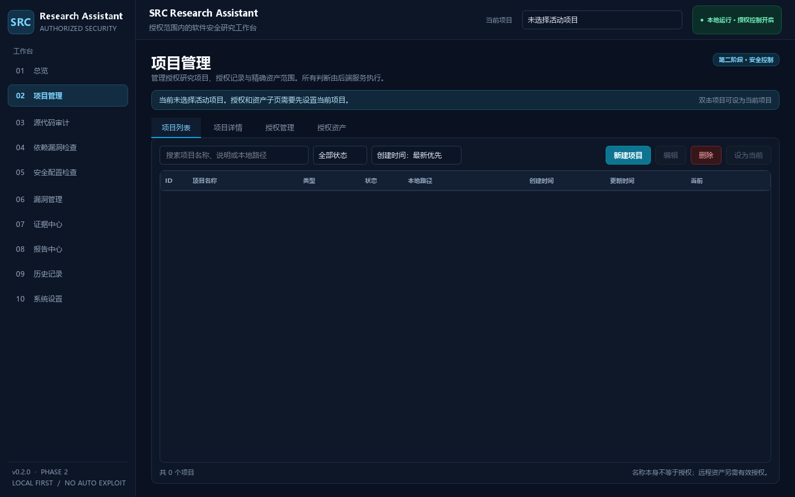

# SRC Research Assistant 第一、二阶段完整验收报告

- 验收时间：2026-11-04 23:03 起（Asia/Shanghai，按实际命令执行顺序连续验收）
- 项目目录：`D:\挖漏洞\SRC-Research-Assistant`
- 运行环境：Windows 11、Python 3.14.4、PySide6 6.12.0、SQLite 3.50.4
- 验收方式：实际启动生产入口、真实 SQLite、真实服务调用、真实 Qt 对话框、pytest、静态检查
- 真实网络目标：**0 个**
- 第三阶段：**未进入，未实现**

## 结论摘要

| 阶段 | 结论 |
|---|---|
| 第一阶段 | **通过**（原生桌面窗口展示受当前会话限制，见 1.4；实际 Qt 窗口、事件循环、页面和关闭均已执行） |
| 第二阶段 | **通过**（验收中发现并修复 1 个真实 UI 缺陷） |
| pytest | **40 passed / 0 failed** |
| 独立业务验收 | **31 passed / 0 failed** |
| 代码质量阻断问题 | **0** |

## 一、第一阶段验收

### 1.1 项目结构与入口

完整目录树已输出：

- `docs/acceptance/project_tree.txt`
- 根目录：`D:\挖漏洞`
- 应用项目：`D:\挖漏洞\SRC-Research-Assistant`
- 实际入口：`SRC-Research-Assistant\main.py`
- 配置：`SRC-Research-Assistant\config.yaml`
- 主数据库：`SRC-Research-Assistant\storage\src_research.db`
- 依赖虚拟环境：`D:\挖漏洞\.venv`（第三方依赖树未展开）

关键目录：

```text
D:\挖漏洞\
├── .venv/
└── SRC-Research-Assistant/
    ├── app/          # 配置、组合根、Qt 启动
    ├── core/         # 模型、错误、时间
    ├── database/     # 统一连接、schema
    ├── security/     # ScopeValidator
    ├── services/     # 项目/授权/资产/审计
    ├── ui/           # 主窗口与 10 个页面
    ├── scanners/     # 未启用边界
    ├── reports/      # 未启用边界
    ├── storage/      # 主库、验收库、日志
    ├── tests/        # 6 个测试文件
    ├── tools/        # 验收与快照工具
    ├── docs/         # 架构、测试、验收、截图
    ├── backups/      # 恢复快照
    ├── main.py       # 实际入口
    ├── config.yaml
    └── requirements.txt
```

### 1.2 Python 环境（实际执行）

| 环境 | 结果 |
|---|---|
| 系统 Python | `D:\Python314\python.exe`，Python **3.14.4**，pip **26.0.1**，系统级 PySide6 **未安装** |
| 应用虚拟环境 | `D:\挖漏洞\.venv\Scripts\python.exe`，Python **3.14.4**，pip **26.3** |
| PySide6 | **6.12.0**（PySide6-Essentials） |
| SQLite | **3.50.4** |

应用运行使用虚拟环境，未修改系统环境变量。

### 1.3 数据库初始化（实际执行）

命令：

```powershell
& 'D:\挖漏洞\.venv\Scripts\python.exe' main.py --init-db
```

实际输出：

```text
数据库: D:\挖漏洞\SRC-Research-Assistant\storage\src_research.db
架构版本: 2
健康状态: SQLite 3.50.4 · 外键 ON
数据表:
  - app_settings
  - authorization_history
  - authorizations
  - evidence
  - findings
  - projects
  - reports
  - scan_logs
  - scan_tasks
  - scope_assets
```

数据库检查：

```text
schema_version=2
foreign_key_violations=0
indexes=12
scope_assets 已存在
主库当前业务行数=0（测试数据写入隔离库，不污染主库）
```

七张第一阶段表全部存在：`projects`、`authorizations`、`scan_tasks`、`findings`、`evidence`、`reports`、`scan_logs`。第二阶段新增表也存在：`scope_assets`、`authorization_history`、`app_settings`。

### 1.4 主程序启动验收

实际调用生产入口 `app.application.main([])`（`main.py` 即调用该函数），通过 offscreen Qt 进入真实事件循环，执行结果：

```text
started=true
visible_after_show=true
navigation labels=10
all 10 navigation clicks ok
closed_normally=true
application_exit_code=0
screenshot_saved=true
success=true
```

十个导航实际名称：

```text
01 总览
02 项目管理
03 源代码审计
04 依赖漏洞检查
05 安全配置检查
06 漏洞管理
07 证据中心
08 报告中心
09 历史记录
10 系统设置
```

界面关闭使用 `QWidget.close()`，Qt 事件循环正常退出，退出码 0。截图：



另一次通过生产入口生成的截图：`entrypoint_runtime.png`。

**环境限制（如实说明）**：当前自动化会话中没有可捕获的原生桌面窗口。以 `pythonw.exe main.py` 启动后进程保持存活，但 Windows `MainWindowHandle=0`，无法取得原生窗口句柄并做桌面截图；因此使用同一套生产入口、`QApplication`、`MainWindow` 和事件循环在 offscreen Qt 中执行并截图。这不是静态代码检查，也不能据此声称原生桌面窗口已经可见。

### 第一阶段状态：通过

已完成：项目骨架、真实入口、10 页导航、深色主窗口、数据库 10 表、页面切换、正常关闭、运行截图。

未完成：无本阶段范围内未完成项；原生桌面窗口无法在当前自动化会话中截图，属于环境限制。

## 二、第二阶段验收

验收使用独立数据库 `storage/acceptance/acceptance.db` 和真实本地服务调用，不访问互联网。

### 2.1 项目管理（实际步骤）

| 步骤 | 结果 | 实际输出 |
|---|---|---|
| 创建项目 | PASS | ID=1，名称=验收临时项目 |
| 查询项目 | PASS | 查询到 #1 验收临时项目 |
| 修改项目 | PASS | 名称=验收临时项目（已修改），状态=已暂停 |
| 设置当前项目 | PASS | 当前项目=#1 |
| 删除测试项目 | PASS | 删除后再查询抛出 NotFoundError |
| 删除后当前项目清理 | PASS | 当前项目已清空 |

### 2.2 授权管理（实际步骤）

| 步骤 | 结果 | 实际输出 |
|---|---|---|
| 创建待审核授权 | PASS | #1，状态=待审核，有效=False |
| 确认授权 | PASS | #1，状态=已确认，有效=True |
| 已确认必须有授权文件 | PASS | 按预期拒绝：确认授权必须填写授权文件路径 |
| 真实时间过期 | PASS | 授权窗口至 23:06，等待约 9 秒后返回 `authorization_expired` |
| 过期状态落库 | PASS | 状态=已过期，本次更新=1 |
| 撤销授权 | PASS | #3，状态=revoked，资产检查返回 `authorization_revoked` |

过期测试使用真实系统时间：短时授权 8 秒后自然到期，不是把返回值写死；到期后校验器仍能在数据库保存状态为 `confirmed` 时拒绝。

验收库最终数据：

```text
projects=2
authorizations=4
scope_assets=7
authorization_history=7
scan_logs=33
foreign_key_violations=0
```

### 2.3 授权范围（实际步骤）

| 测试 | 结果 | 实际输出 |
|---|---|---|
| 本地测试项目路径允许 | PASS | asset=#1，`code=allowed` |
| 范围外本地路径拒绝 | PASS | `local_target_not_in_scope` |
| `example.test` 允许 | PASS | `allowed` |
| `authorized.example.test` 允许 | PASS | `allowed` |
| `outside.test` 拒绝 | PASS | `target_not_in_scope` |
| 未登记子域 `other.example.test` 拒绝 | PASS | `target_not_in_scope` |
| 通配符 `*.example.test` 拒绝 | PASS | ValidationError |
| 过期授权目标拒绝 | PASS | `authorization_expired` |
| 撤销授权目标拒绝 | PASS | `authorization_revoked` |
| URL 不作为精确目标 | PASS | 被拒绝 |
| 直接插入无授权资产 | PASS | `missing_authorization` |

所有域名均为保留的 `.test` 模拟域名，没有 DNS 查询或 HTTP 请求。

### 2.4 数据隔离（实际步骤）

| 测试 | 结果 | 实际输出 |
|---|---|---|
| 项目 A 读取项目 B 授权 | PASS | NotFoundError |
| 项目 A 读取项目 B 资产 | PASS | NotFoundError |
| 项目资产列表隔离 | PASS | A 的 5 个资产不包含 B 的资产 |
| B 检测不写入 A 日志 | PASS | A 日志数 22 → 22 |
| A/B 检测记录集合不相交 | PASS | A=22，B=4，交集=0 |
| B 不能使用 A 的目标范围 | PASS | `target_not_in_scope` |

### 2.5 pytest 自动化测试

命令：

```powershell
cd D:\挖漏洞\SRC-Research-Assistant
$env:QT_QPA_PLATFORM='offscreen'
& 'D:\挖漏洞\.venv\Scripts\python.exe' -m pytest -q -p no:cacheprovider
```

实际输出：

```text
........................................                                 [100%]
40 passed in 6.14s
```

- 总测试数：**40**
- 通过：**40**
- 失败：**0**
- 跳过：**0**

测试分布：

| 文件 | 数量 |
|---|---:|
| `tests/test_database.py` | 4 |
| `tests/test_project_service.py` | 7 |
| `tests/test_authorization_service.py` | 8 |
| `tests/test_scope_validator.py` | 16 |
| `tests/test_ui.py` | 2 |
| `tests/test_ui_dialogs.py` | 3 |

## 三、代码质量检查（实际执行）

执行：

```powershell
& 'D:\挖漏洞\.venv\Scripts\python.exe' tools\code_quality_check.py
```

### 3.1 空函数与 pass

- 空函数：**0**
- `pass` 语句：**4**
- 位于函数体中的空实现：**0**
- 4 个 pass 全部位于异常处理分支：

| 文件 | 行 | 上下文 |
|---|---:|---|
| `app/application.py` | 55 | `ExceptHandler` |
| `database/connection.py` | 68 | `ExceptHandler`（回滚异常保护） |
| `security/scope_rules.py` | 44 | `ExceptHandler`（IP/域名判别） |
| `security/scope_validator.py` | 69 | `ExceptHandler`（先判 IP 再判域名） |

### 3.2 TODO 与未完成标记

`TODO/FIXME`：**0**。占位页面使用明确的“未开发”状态，不冒充完成。

### 3.3 UI 是否直接调用扫描器

- UI 对 `scanners`、`bandit`、`semgrep`、`pip_audit`、`requests`、`socket`、`urllib`、`http` 的直接导入：**0**
- UI 直接 SQL 语句：**0**
- UI 仅导入项目服务和 ViewModel/State。

### 3.4 数据库是否集中管理

- `sqlite3.connect` 仅出现在 `database/connection.py`：**1 处**
- UI 没有数据库连接或 SQL。
- 外键、事务、迁移统一在 `Database` 中管理。
- **可改进项（非阻断）**：SQL 字符串分布在 `services/` 各服务中，尚未抽出独立 repository 层；当前规模下连接集中、UI 隔离，未见绕过或数据错乱。

### 3.5 授权检查是否可被简单绕过

实际动态绕过测试均被拒绝：

- 范围外域名；
- 未登记子域；
- 通配符资产；
- 过期授权资产；
- 已撤销授权资产；
- 跨项目读取授权/资产；
- 跨项目使用范围；
- URL 伪装目标；
- 绕过服务层直接向数据库插入无授权资产；
- 审计写入失败时 fail-closed。

未发现仅通过 UI 隐藏、直接调用服务或直接插入无授权资产即可放行的路径。

### 3.6 硬编码授权状态

- 状态字面量集中在 `AuthStatus` 枚举、数据库 CHECK 约束、服务查询与 UI 标签映射中。
- 静态扫描在安全层/UI 中发现可疑的硬编码 `confirmed` 放行：**0**。
- 授权是否有效由数据库记录、状态、来源/文件完整性和起止时间共同判断，没有固定返回有效。

### 3.7 验收期间实际发现并修复的问题

1. **产品缺陷**：`ScopeAssetDialog` 构造时缺少 `AssetStatus` 导入，真实控件测试首次报 `NameError`。
   - 修复：恢复 `AssetStatus` 导入。
   - 回归：`test_ui_dialogs.py` 3/3 通过，全量 40/40 通过。
2. **验收脚本缺陷**：`acceptance_ui.py` 首次运行漏调用 `window.show()`，导致 `visible_after_show=false`。
   - 修复：补上 `window.show()`。
   - 回归：入口启动验收通过。
3. **环境限制**：原生桌面窗口句柄不可获得，见 1.4。

## 四、最终状态

### 【第一阶段】

状态：**通过**

已完成：

- 项目目录、入口、配置、数据库、日志和存储骨架；
- 深色 PySide6 主窗口和 10 个导航页；
- 页面切换、最大化/关闭能力、正常事件循环退出；
- 7 张第一阶段表 + 第二阶段新增表；
- 实际运行截图。

未完成：

- 原生 Windows 桌面窗口截图受当前自动化会话限制；不影响 Qt 功能验证。

### 【第二阶段】

状态：**通过**

已完成：

- 项目 CRUD、搜索、筛选、排序、当前项目；
- 授权创建、确认、过期、撤销、历史、有效性判断；
- 域名/IP/本地资产、精确匹配、操作白名单；
- 跨项目数据隔离；
- 默认拒绝、审计、fail-closed、绕过防护；
- 实际 Qt 项目/授权/资产对话框保存与校验。

未完成：

- 本阶段范围内无未完成功能；
- 扫描器、依赖审计、远程检查、漏洞、证据、报告仍是明确的后续阶段。

### 【测试结果】

- pytest 总测试数：**40**
- 通过：**40**
- 失败：**0**
- 独立业务验收：**31 / 31 PASS**
- 验证期间失败：资产对话框 `AssetStatus` 导入缺陷 1 次，已修复并全量回归通过；验收脚本 `show()` 缺陷 1 次，已修复。

### 【项目快照】

完整源码、验收数据库、验收日志、截图和本报告已打包为可校验快照：

```text
D:\挖漏洞\SRC-Research-Assistant\backups\src-research-assistant_acceptance_final.zip
```

SHA-256 在最终回复中提供。

### 【建议】

从验收结果看：**可以进入第三阶段**。

但按本次明确指令：**不进入第三阶段**。下一阶段应先从本地 Python 源代码审计开始，最后再实现远程非破坏性配置检查；所有远程入口必须复用现有 `ScopeValidator`、展示授权状态并记录审计。
