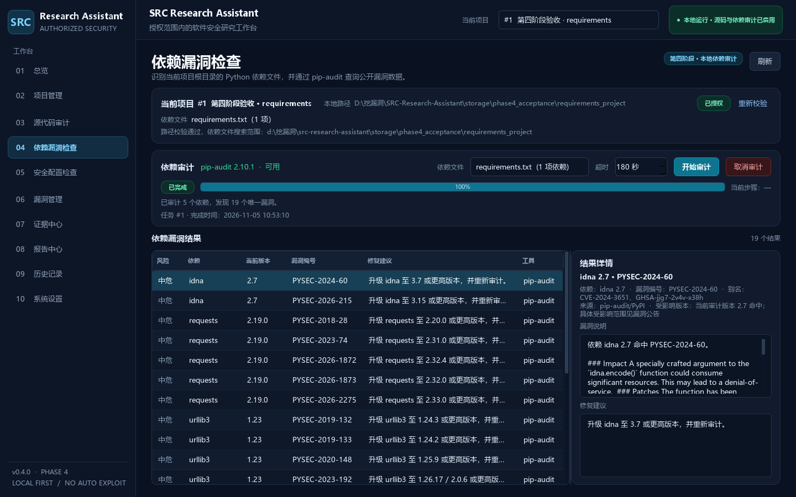

# 第四阶段验收报告：Python 依赖漏洞审计

- 验收时间：2026-11-05（Asia/Shanghai）
- 项目：`D:\挖漏洞\SRC-Research-Assistant`
- 版本：`0.4.0`
- 数据库 schema：v4
- 结论：**通过**
- 真实远程目标：0 个；仅使用 pip-audit 的公开漏洞数据服务和包索引解析依赖

## 1. 开发前基线

| 项目 | 实际结果 |
|---|---|
| 原有测试 | **81 passed / 0 failed / 0 skipped**，19.36s |
| 原有 schema | v3 |
| 扫描器接口 | `BaseScanner`、`BanditScanner`、`SemgrepScanner` 已存在 |
| 任务模型 | `ScanTask` 已存在（source_audit） |
| Finding 模型 | 已存在（无 metadata 字段） |
| Repository | 项目中不存在独立 Repository 层，沿用 Service + Database |
| 隔离 | project_id / task_id 查询隔离已存在 |
| pip-audit | 未安装 |
| 依赖页面 | 占位页 |

没有重新创建项目或重复数据模型，没有进行大规模重构。

## 2. 已完成功能

1. **依赖文件识别**
   - 仅检查当前项目根目录的 `requirements.txt`、`pyproject.toml`。
   - 符号链接和项目根目录外路径被拒绝。
   - 两者同时存在时优先 requirements.txt。
   - 无可审计依赖文件时不创建任务，UI 显示“未发现可审计依赖”。

2. **pip-audit 集成**
   - 实际安装并运行 `pip-audit 2.10.1`。
   - 安全参数列表调用，`shell=False`。
   - 项目自有 `--cache-dir`、`TMP/TEMP`，避免依赖用户默认缓存。
   - JSON 输出、超时、取消、执行失败、解析失败处理。
   - 检测到 0 个已审计依赖时标记 failed，绝不伪装“无漏洞”。

3. **pyproject.toml**
   - 支持 PEP 621 `[project].dependencies`。
   - 在项目自有临时目录转换为 requirements 输入，任务结束清理。
   - 不受支持或无依赖时明确显示不可审计。

4. **统一 Finding**
   - 复用现有 Finding，不新增结果表。
   - 依赖漏洞包含依赖名称、版本、漏洞编号、别名、修复版本、受影响说明、来源。
   - 数据库 v4 新增 `metadata_json`。
   - 标题、风险、描述、规则、扫描器版本、检测时间完整。
   - pip-audit 重复公告按依赖+漏洞编号去重。

5. **ScanTask 集成**
   - 任务类型 `dependency_audit`。
   - `pending → running → completed / failed / cancelled`。
   - 复用异常状态、进度、错误、开始/完成时间字段。
   - 结果按项目和任务隔离。
   - 取消不会标记 completed；0 审计依赖不会标记 completed。

6. **依赖漏洞检查页面**
   - 当前项目、本地路径、路径授权状态。
   - requirements.txt / pyproject.toml 识别结果与依赖数量。
   - 依赖文件选择（两者都存在时可选）。
   - pip-audit 可用性/版本。
   - 开始/取消、超时。
   - 状态、当前步骤、进度、错误、完成时间。
   - 结果表：风险、依赖、当前版本、漏洞编号、修复建议、工具。
   - 点击查看依赖、版本、漏洞编号、别名、来源、受影响版本、说明、修复建议。
   - 后台 QThread，UI 不直接调用 pip-audit。

## 3. 数据库变化

- schema v3 → v4。
- `findings` 新增 `metadata_json TEXT NOT NULL DEFAULT '{}'`。
- 无新增表、无重复结果表。
- v3→v4 前自动备份：
  `storage/backups/src_research_v3_20261105T024055Z.db`。
- 主库实际版本：v4，10 张表，15 个索引，外键 0 违规。

## 4. 实际 pip-audit 验证

隔离验收库：`storage/phase4_acceptance/acceptance.db`。

| 项目 | 输入 | 审计依赖数 | 唯一漏洞数 | 任务状态 |
|---|---|---:|---:|---|
| requirements | `requests==2.19.0` | 5 | 19 | completed |
| pyproject | PEP 621 dependencies | 5 | 19 | completed |
| safe | `six==1.16.0` | 1 | 0 | completed |

验收库统计：

```text
projects=3
scan_tasks=3 (dependency_audit)
findings=38
scan_logs=33
foreign_key_violations=0
```

真实 Finding 示例：

```text
requests 2.19.0 · PYSEC-2018-28
依赖：requests 2.19.0
漏洞编号：PYSEC-2018-28
别名：CVE-2018-18074
修复：升级 requests 至 2.20.0 或更高版本
来源：pip-audit/PyPI
文件：requirements.txt 第 1 行
```

UI 实际截图：



## 5. 测试结果

```powershell
$env:QT_QPA_PLATFORM='offscreen'
& 'D:\挖漏洞\.venv\Scripts\python.exe' -m pytest -q -p no:cacheprovider
```

```text
........................................................................ [ 68%]
.................................                                        [100%]
105 passed in 25.16s
```

- 总测试数：**105**
- 通过：**105**
- 失败：**0**
- 跳过：**0**

新增测试 24 项：pip-audit 8、依赖服务 15、依赖 UI 1。

## 6. 代码质量

```text
PRODUCT_FILES=53
EMPTY_FUNCTIONS=0
PASS_STATEMENTS=16
EXCEPT_HANDLERS=11
EXCEPTION_CLASSES=5
OUTSIDE=0
TODO=0
UI_SCANNER_IMPORTS=0
UI_SQL_STATEMENTS=0
SUSPICIOUS_CONFIRMED_ALLOW=0
```

- 无空函数伪装。
- pass 全部在异常处理或明确异常类。
- UI 不直接访问 scanners/SQL。
- sqlite3.connect 仍只在 `database/connection.py`。
- 授权硬编码放行：0。

## 7. 新增文件

```text
scanners/pip_audit_scanner.py
services/dependency_audit_service.py
tests/test_pip_audit_scanner.py
tests/test_dependency_audit_service.py
tests/test_ui_dependency_audit.py
tools/run_phase4_acceptance.py
tools/capture_phase4_ui.py
docs/PHASE4_ARCHITECTURE.md
docs/acceptance/PHASE4_TEST_REPORT.md
docs/acceptance/PHASE4_ACCEPTANCE_REPORT.md
docs/acceptance/phase4_acceptance.json
docs/acceptance/phase4_dependency_audit.png
```

## 8. 修改文件

```text
app/__init__.py                  # 版本 0.4.0
app/bootstrap.py                 # 注入 PipAuditScanner / DependencyAuditService
app/config.py                    # 默认版本 0.4.0
config.yaml                      # 版本 0.4.0
requirements.txt                 # 加入 pip-audit
core/models/finding.py           # 增加 metadata / metadata_json 兼容
database/schema.py               # schema v4
database/connection.py           # v3→v4 迁移
scanners/__init__.py             # 导出 PipAuditScanner
services/scan_service.py         # 源码扫描 Finding 写入 metadata_json，保持兼容
ui/main_window.py                # 接入依赖页面、关闭等待线程、PHASE 4
ui/dependency_page.py            # 占位页替换为实际依赖审计页面
ui/dashboard.py                  # 阶段标识更新
ui/project_page.py               # 阶段标识更新
ui/settings_page.py              # 本阶段说明更新
ui/config_audit_page.py          # “当前阶段”措辞修正
tests/test_database.py           # v2→v4 迁移断言
README.md                        # 第四阶段说明、105 测试、截图
docs/ARCHITECTURE.md             # 历史阶段说明
```

生成/更新证据：

- `docs/acceptance/phase4_acceptance.json`
- `docs/acceptance/phase4_dependency_audit.png`
- `docs/acceptance/code_quality.json`
- `docs/acceptance/project_tree.txt`

## 9. 已知问题

1. **pip-audit JSON 不提供 CVSS/severity**：应用保守映射为 `medium`，metadata 标记 `severity_source=conservative-default`，需人工复核漏洞公告。
2. **pip-audit JSON 不提供精确 affected version range**：metadata 记录当前命中版本和“具体范围见公告”的说明，不伪造范围。
3. **依赖公开漏洞服务需要网络**：离线漏洞库未实现；网络/服务失败会明确标记 failed，不会被当作无漏洞。
4. **pyproject 仅支持 PEP 621 `[project].dependencies`**：不处理 Poetry、optional dependency groups 或构建依赖。
5. **未审计到任何依赖会 failed**：这是有意的 fail-safe 设计，避免把“没有扫描”显示成“没有漏洞”。
6. **Semgrep Windows 运行时验证仍待完成**，见下文。
7. 应用异常强杀后的 running 任务自动恢复未实现。

上述问题不影响本阶段依赖审计主流程。

## 10. Semgrep 待办状态

- 保留第三阶段真实状态：Semgrep 1.183.0 已安装，但 `semgrep.exe`/`semgrep-core.exe` 在当前 Windows 会话因
  `ca_certs_iter_on_anchors: CertOpenSystemStore returned NULL` 无法启动。
- 未删除、未伪造、未改为“已完成”。
- 后续应在 Linux/WSL 或其他正常环境完成：
  1. 本地规则语法运行验证；
  2. 实际测试项目扫描；
  3. Finding JSON 解析验证；
  4. UI 结果验证。
- 此待办不阻塞第四阶段。

## 11. 阶段快照

```text
D:\挖漏洞\SRC-Research-Assistant\backups\src-research-assistant_phase4_final.zip
```

具体 SHA-256 在最终回复中提供。

## 12. 下一阶段建议

1. 完成漏洞管理与证据中心，统一引用源码扫描和依赖审计 Finding。
2. 再做 HTML/PDF/JSON 报告。
3. 远程配置检查必须复用授权范围与 DNS/重定向校验。
4. 在 Linux/WSL 补做 Semgrep 实际运行验证。
5. 最后进行 Windows EXE 打包。

第四阶段到此停止，不进入第五阶段。
