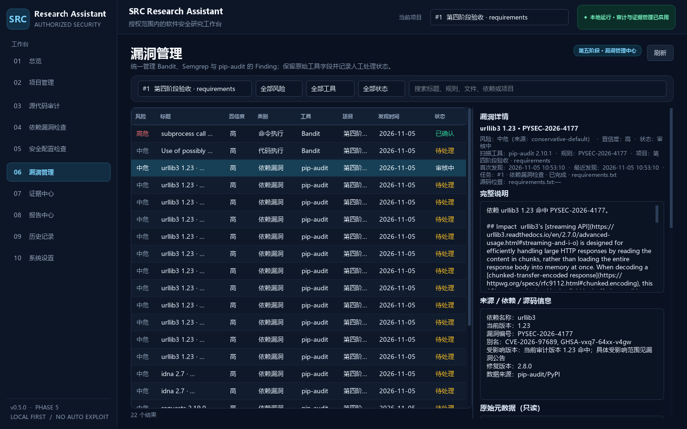
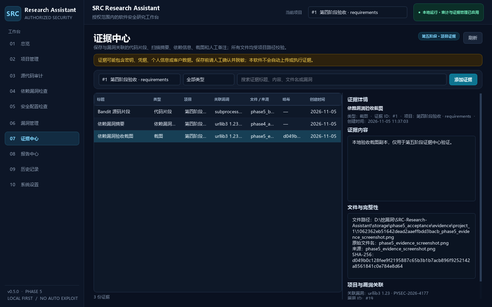

# 第五阶段验收报告：漏洞管理中心与证据中心

- 验收时间：2026-11-05（Asia/Shanghai）
- 项目：`D:\挖漏洞\SRC-Research-Assistant`
- 版本：`0.5.0`
- 数据库：schema v5
- 结论：**通过**（1 项 Windows 环境限制：真实文件符号链接创建被系统拒绝，已用目录联接实际测试 + `is_symlink` 单元模拟覆盖）
- 真实远程目标：0 个
- 本阶段未进入报告、远程配置检查、网络探测或利用阶段

## 1. 开发前基线

| 项目 | 结果 |
|---|---|
| 原有测试 | **105 passed / 0 failed / 0 skipped**，24.89s |
| schema | v4 |
| 统一 Finding | 已存在 |
| ScanTask | 已存在 |
| 项目隔离 | 已存在 |
| 本地路径校验 | `ScopeValidator.check_local_path` 已存在 |
| evidence 表 | 存在旧字段，无类型/标题/来源 |
| findings.status CHECK | 不允许 `reviewing` |
| Repository | 原项目没有 Repository 层 |
| 漏洞/证据页面 | 占位页 |

## 2. 已完成功能

### A. 漏洞管理中心

- 统一读取 Bandit、Semgrep、pip-audit Finding，不混合原始工具字段。
- 保留扫描器名称/版本、规则编号、项目、任务、文件/行号、依赖 metadata。
- 六种状态：待处理、审核中、已确认、误报、已修复、接受风险。
- 状态持久化，记录 `status_changed_at`。
- 状态历史追加写入 `finding_status_history`，记录旧/新状态、备注、操作者、时间。
- 人工备注持久化到 `findings.manual_notes`。
- 详情包含：
  - 完整标题/描述、风险与来源；
  - 工具与版本、规则、项目、任务；
  - 首次/最近发现时间；
  - 源码路径/行号或依赖名称/版本/编号/别名/修复版本/来源；
  - 原始 metadata；
  - 关联证据、状态历史。
- 支持项目、风险、扫描器、状态筛选和关键词搜索。
- 所有变更按 `project_id + finding_id` 限定；跨项目读/写被拒绝。

### B. 证据中心

- 类型：代码片段、扫描器结果摘要、依赖漏洞信息、截图、人工备注、其他本地证据文件。
- 一条 Finding 可关联多份证据；一份证据只属于当前项目和 Finding。
- 文件证据复制到 `storage/evidence/project_<id>/<uuid>_<name>`，不覆盖同名文件。
- 保存来源相对路径、原文件名、SHA-256、创建时间、证据类型、标题和描述。
- 文件源必须：
  - 是绝对路径；
  - 项目有本地路径并已登记有效本地资产；
  - 通过 `ScopeValidator.check_local_path`；
  - 真实文件且位于项目根目录内；
  - 拒绝 `..` 越界；
  - 拒绝符号链接/目录联接解析到项目外；
  - 不超过 50 MB。
- 不执行、不上传证据。
- 添加前必须人工勾选敏感信息确认；界面显示脱敏提醒。
- 删除前明确确认；删除证据记录和受管副本，不删除源文件，不删除 Finding。
- 证据详情可跳转漏洞；漏洞详情可查看/跳转证据。

### C. Repository 与 Service

新增：

- `VulnerabilityRepository`
- `EvidenceRepository`
- `VulnerabilityService`
- `EvidenceService`

没有重构第三/第四阶段扫描 Service；新增 Repository 仅服务第五阶段。`AppContext` 注入两个新 Service。

### D. GUI

- 漏洞管理页面、漏洞详情侧栏。
- 证据中心页面、证据详情侧栏。
- 添加证据对话框。
- 页面均保持深色现有主题。
- 列表查询使用 QThread；证据文件复制在 QThread 对话框 worker 中执行。
- 跨页跳转：漏洞→证据、证据→漏洞。

## 3. 数据库 Schema 与迁移

### 版本

**v4 → v5**

### 变更

`findings`：

- 重建表以支持 `reviewing` 状态；
- 保留全部原有字段和行；
- 新增 `manual_notes`；
- 新增 `status_changed_at`；
- 新增 `last_seen_at`；
- 回填 `last_seen_at = COALESCE(detected_at, created_at)`。

`evidence`：

- 新增 `evidence_type`；
- 新增 `title`；
- 新增 `source`；
- 保留原 `file_path`、`file_name`、`sha256`、`captured_at`、`description`、`created_at`。

新增表：

- `finding_status_history`
  - `history_id`
  - `project_id`
  - `finding_id`
  - `from_status`
  - `to_status`
  - `note`
  - `changed_by`
  - `changed_at`

### 迁移安全

- 迁移前 checkpoint WAL 并复制数据库到 `storage/backups/`。
- v5 使用显式 `BEGIN IMMEDIATE`。
- 重建 findings 时临时关闭外键，完成后恢复。
- 任一步失败：rollback；原 v4 数据库仍可打开；备份可恢复。
- 测试覆盖：
  - v2→v5；
  - v4→v5 数据保留；
  - 部分 DDL 后失败回滚；
  - 备份复制恢复。

主库实际迁移：

```text
storage/src_research.db: v4 → v5
backup: storage/backups/src_research_v4_20261105T034341Z.db
tables=11
indexes=18
foreign_key_violations=0
```

阶段验收库：

```text
storage/phase5_acceptance/acceptance.db
schema=5
projects=3
findings=41
evidence=3
finding_status_history=2
scan_tasks=4
scan_logs=56
foreign_key_violations=0
```

## 4. 新增文件

```text
core/models/evidence.py
repositories/__init__.py
repositories/vulnerability_repository.py
repositories/evidence_repository.py
services/vulnerability_service.py
services/evidence_service.py
ui/evidence_dialog.py
tests/phase5_helpers.py
tests/test_vulnerability_service.py
tests/test_evidence_service.py
tests/test_phase5_migration.py
tests/test_ui_phase5.py
tools/run_phase5_acceptance.py
tools/capture_phase5_ui.py
docs/PHASE5_ARCHITECTURE.md
docs/acceptance/PHASE5_TEST_REPORT.md
docs/acceptance/PHASE5_ACCEPTANCE_REPORT.md
docs/acceptance/phase5_acceptance.json
docs/acceptance/phase5_vulnerability_management.png
docs/acceptance/phase5_evidence_center.png
```

## 5. 修改文件

```text
app/__init__.py                  # 0.5.0
app/bootstrap.py                 # Repository + 两个新 Service 注入
app/config.py                    # 默认 0.5.0
config.yaml                      # 0.5.0
core/models/enums.py             # FindingStatus / EvidenceType
core/models/finding.py           # 状态、备注、时间、历史模型
core/models/__init__.py          # 导出新模型
database/schema.py               # v5 表/列/索引
database/connection.py           # v5 事务迁移、回滚、备份
services/scan_service.py         # 新 Finding 写 last_seen_at
services/dependency_audit_service.py # 新 Finding 写 last_seen_at
ui/vulnerability_page.py         # 占位页替换为漏洞管理中心
ui/evidence_page.py              # 占位页替换为证据中心
ui/evidence_dialog.py            # 新增证据对话框
ui/main_window.py                # 页面注入、跨页跳转、PHASE 5、关闭等待
ui/dashboard.py                  # 阶段标识
ui/settings_page.py              # 阶段说明
ui/widgets.py                    # 漏洞状态颜色
tests/test_database.py           # v5 断言
README.md                        # 第五阶段说明、126/1、截图
docs/ARCHITECTURE.md             # 指向第五阶段架构
docs/acceptance/project_tree.txt # 重新生成
docs/acceptance/code_quality.json# 重新生成
```

## 6. 测试结果

```text
126 passed / 0 failed / 1 skipped in 38.61s
127 collected
```

新增：

- 漏洞服务 6 项；
- 证据服务 11 项（10 pass + 1 skip）；
- 迁移 2 项；
- 第五阶段 UI 3 项；
- 既有回归 100 项（105 基线中 database 5 项有修改断言，仍全部通过）。

跳过项：

```text
当前 Windows 会话无法创建文件符号链接：
WinError 1314 客户端没有所需的特权
```

未把该跳过项说成实际通过。

## 7. 项目隔离测试结果

- 跨项目 `get_detail`：`NotFoundError`；
- 跨项目 `change_status`：`NotFoundError`，原 Finding 状态未变；
- 跨项目 evidence add：`NotFoundError`；
- 项目 A/B 列表只返回各自 Finding；
- 数据库外键违规：**0**；
- Repository 的所有单条查询/更新/删除均带 `project_id`；
- UI 项目筛选不会改变记录归属；
- 证据记录强制关联当前项目和该项目下的 Finding。

## 8. 证据路径安全测试结果

| 测试 | 结果 |
|---|---|
| 项目外绝对路径 | 拒绝（未通过 `relative_to(project_root)`） |
| `..` 路径遍历 | 拒绝（实际测试） |
| 未登记本地资产 | `AuthorizationDenied` |
| 相对路径 | `ValidationError` |
| Windows 目录联接指向项目外 | 拒绝（实际 junction 测试） |
| 文件符号链接指向项目外 | 当前会话无法创建（skip） |
| `Path.is_symlink` 显式分支 | 通过单元 monkeypatch 测试（模拟） |
| SHA-256 | 实际文件复制后与源哈希一致 |
| 同名文件 | UUID 前缀生成不同受管副本 |
| 删除证据 | 源文件仍在、Finding 仍在、受管副本删除 |
| 证据文件执行/上传 | 没有实现入口 |

## 9. 真实数据与 UI

第五阶段验收库由第四阶段真实 pip-audit 验收库复制后迁移到 v5，并在本地授权项目执行真实 Bandit：

```text
项目 1（requirements）：
  Bandit: 3 条（本阶段真实本地扫描）
  pip-audit: 19 条（第四阶段真实数据）
  合计: 22 条
  证据: 3 份
  状态历史: 2 条
  状态: 20 open, 1 reviewing, 1 confirmed
```

全库：

```text
projects=3
findings=41
evidence=3
status_history=2
foreign_key_violations=0
```

真实证据文件哈希：

```text
d049b0c128fee9f2195887c65b3b1b7acb896f9252142a8561841c0e784e8d64
```

截图：





截图来自真实验收数据库；页面加载、筛选、状态保存、跨页跳转和删除由 Qt UI 测试验证。

## 10. 真实 / 模拟 / 单元测试声明

- **真实执行**：
  - 本地 Bandit 扫描；
  - 第四阶段 pip-audit 真实验收数据迁移；
  - 真实本地 PNG 文件复制和 SHA-256；
  - v4→v5 迁移；
  - Qt offscreen 页面加载与交互。
- **测试夹具/模拟**：
  - Semgrep Finding 的“三扫描器统一列表”只由临时数据库夹具覆盖；Semgrep 运行时仍不可用。
  - 文件符号链接实际创建失败，`is_symlink` 分支是模拟单元测试。
- **单元测试**：状态、历史、隔离、筛选、迁移失败回滚。
- **UI 测试**：Qt offscreen 页面/对话框，不连接真实目标。
- **未实际验证**：
  - Semgrep 实际运行；
  - 当前 Windows 会话的真实文件符号链接创建；
  - 报告、远程配置检查（本阶段未开发）。

## 11. 尚未解决的问题

1. 文件符号链接实际创建受 Windows 权限限制；当前只能确认目录联接实际拒绝和显式分支单元行为。
2. Semgrep 的 Windows CA 存储问题仍未解决。
3. 未做跨扫描逻辑去重；“首次/最近发现”按每条 Finding 记录，不对相同问题多行合并。
4. 列表上限 1000；更大量需要分页。
5. 证据只允许从授权项目根目录导入；项目外截图必须先复制到项目内。
6. 本阶段未实现报告导出、远程检查或证据外部同步。

## 12. 阶段快照

```text
D:\挖漏洞\SRC-Research-Assistant\backups\src-research-assistant_phase5_final.zip
```

SHA-256 在最终回复中提供。

## 13. 停止点

第五阶段在此停止。未自动开始报告模块，等待用户审查第五阶段验收结果。
